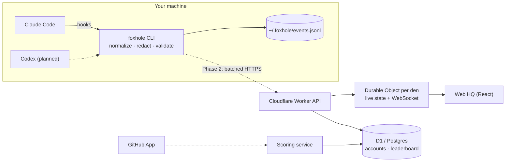

# Foxhole HQ

> See your agents work, know when they need you, and watch them level up.

Foxhole HQ turns AI coding agents (Claude Code, Codex and others) into pixel foxes living on a live isometric HQ floor. Every repo is a den, every branch gets its own corner, and each fox acts out what its agent is doing in real time: reading at the bookshelf, typing at its desk, running commands at the server rack, raising a paw when it needs your permission.

The full product plan lives in [PLAN.md](PLAN.md). An interactive prototype of the HQ floor is in [`apps/web/prototype`](apps/web/prototype/index.html): open it in a browser.

## Status

| Phase | What                                                    | State                                                  |
| ----- | ------------------------------------------------------- | ------------------------------------------------------ |
| 0     | Claude Code plugin records metadata-only events locally | **Built**, verified against a real Claude Code session |
| 1     | Local server, live web HQ, XP and achievements          | Next                                                   |
| 2     | Hosted dens on Cloudflare, GitHub sign-in, phone alerts | Planned                                                |
| 3     | Verified global leaderboard (impact per token)          | Planned                                                |

## Architecture



- **One event contract.** Every adapter normalizes into a single versioned schema ([`packages/schema`](packages/schema/src/event.ts)), validated with Zod at the edge of every component. The schema is strict: an unknown field fails validation, so nothing beyond metadata can be sent by accident.
- **Privacy by construction.** Hooks see prompts, file contents and command output, but only short labels leave the hook: a relative file path, a command name with secrets-looking arguments cut off, a hostname. Labels can be hashed or hidden entirely. Redaction rules are unit-tested against real secret patterns.
- **Hooks never hurt the agent.** The CLI is one self-contained file run by `node`, prints nothing, always exits 0, and has a 5 second timeout.
- **Append-only local log.** Events are JSON Lines with UUIDs and UTC timestamps, so they can be replayed, de-duplicated and batched to the server later. Token usage is read incrementally from the agent's transcript with a byte-offset cursor, so each turn is counted exactly once.
- **Scales per den.** In the hosted version each den is its own Durable Object holding live state and fanning out WebSocket updates, so load spreads across repos instead of one central server.

## Tech stack

| Area                  | Choice                                   |
| --------------------- | ---------------------------------------- |
| Language              | TypeScript (strict) on Node 22           |
| Monorepo              | pnpm workspaces + Turborepo              |
| Validation            | Zod                                      |
| Testing               | Vitest                                   |
| Lint / format         | ESLint (typescript-eslint) + Prettier    |
| Bundling              | tsup (esbuild)                           |
| Versioning & releases | Changesets + GitHub Releases             |
| CI/CD                 | GitHub Actions                           |
| Web (Phase 1)         | React + Vite, canvas isometric renderer  |
| Backend (Phase 2)     | Cloudflare Workers + Durable Objects, D1 |

## Repo layout

```
packages/
  schema/          the event contract (Zod) shared by everything
  agent/           the foxhole CLI: normalize, redact, read token usage, append
  plugin-claude/   Claude Code plugin: hook config + bundled CLI
apps/
  web/prototype/   interactive HQ floor prototype
.claude-plugin/    plugin marketplace manifest
```

## Getting started

```sh
corepack enable          # provides the pinned pnpm version
pnpm install
pnpm test                # builds what the tests need, then runs them
pnpm build
```

### Try the plugin (Phase 0)

From a clone of this repo:

```sh
pnpm build
claude --plugin-dir packages/plugin-claude
```

Use Claude Code as usual, then look at what was recorded:

```sh
node packages/plugin-claude/dist/foxhole.mjs tail     # last 20 events
node packages/plugin-claude/dist/foxhole.mjs stats    # sessions, tool calls, tokens
```

Events are written to `~/.foxhole/events.jsonl`. Put `{ "targets": "hash" }` or `{ "targets": "hidden" }` in `~/.foxhole/config.json` to hash or drop file names and commands. Set `FOXHOLE_DEBUG_SHAPES=1` to also log which keys each hook payload had (names only, never values), which helps when Claude Code adds new hook fields.

### Test from your phone (cloud sessions)

This repo dogfoods itself: `.claude/settings.json` wires the same hooks to the committed bundle, so any Claude Code session working on this repo records events, including cloud sessions started from the Claude app on a phone. Nothing to install or build. Ask Claude in that session to run `node packages/plugin-claude/dist/foxhole.mjs stats` (or `tail`) to see what was recorded. The repo hooks also set `FOXHOLE_DEBUG_SHAPES=1`, so `~/.foxhole/payload-shapes.jsonl` shows which fields each hook received (names only). Cloud containers are temporary, so check the log before the session ends.

Once this is on `main`, it can also be installed as a plugin: `/plugin marketplace add prajeshgpat/foxhole-hq`, then `/plugin install foxhole@foxhole-hq`.

## Contributing

Work happens on `dev` and reaches `main` only through reviewed pull requests with green CI. See [CONTRIBUTING.md](CONTRIBUTING.md).

## License

[MIT](LICENSE)
